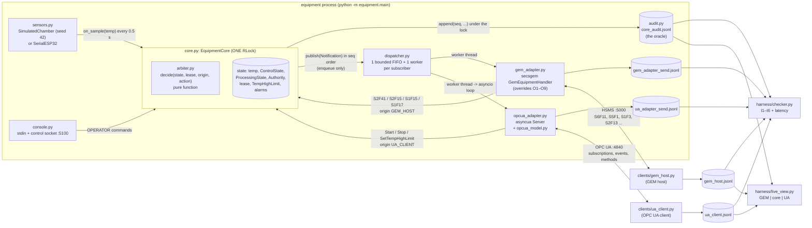

# Architecture (N1)

One simulated process tool, **one** authoritative core, two protocol "doors" that own no equipment state, and one
arbiter that every command passes through. Everything the core does is written to a sequence-numbered audit log,
and the doors and clients log what they send and receive, so consistency can be *checked*, not assumed (N3).

## Component roles

| Component | Role | Owns state? | Novelty |
|---|---|---|---|
| `equipment/config.py` | Every ID, port and default in one place (SVIDs 1–5, DVIDs 101–104, ECID 201, CEIDs 1001–1007, ALID 5001, RCMDs). | no | N1, N2 |
| `equipment/core.py` | The ONLY owner of equipment state. `submit_command`, `submit_ec_write`, `set_control_state`, `set_lease`: take the lock → ask the arbiter → check preconditions → apply → audit with seq → enqueue notifications → release. | **yes** | N1 |
| `equipment/arbiter.py` | Pure policy function (no I/O, no state): who may do what in which control state (`docs/arbitration.md`). | no | N1 |
| `equipment/audit.py` | Global monotonic seq + flushed JSONL; the oracle of the consistency method. | the log | N3 |
| `equipment/dispatcher.py` | One bounded FIFO (10 000) + one worker per subscriber. The core only enqueues; a slow or dead door never blocks the core or the other door. Overflow drops the oldest item and audits `kind=dropped`. | queues only | N1, N3 |
| `equipment/gem_adapter.py` | GEM door. Reads come from the core; commands go to the core; events/alarms are sent from its dispatcher worker in seq order. Logs `sent`/`dropped_*`/`error` per event. Overrides secsgem defaults that would bypass the arbiter (`docs/library_overrides.md`). | GEM report definitions only (see mapping: report scope) | N1, N2 |
| `equipment/opcua_model.py` + `opcua_adapter.py` | OPC UA door. GEM-derived draft model built types-first; methods → core; variables/events mirrored from notifications with SourceTimestamp = core time. | no | N1, N2 |
| `equipment/console.py` | Operator = third origin, through the same arbiter. Control socket for the harness. | no | N1 |
| `clients/*` | Independent processes that log everything they receive (receive-side logs). | — | N3 |
| `harness/checker.py`, `scenarios.py` | Invariants I1–I6 over the logs; scenarios S1–S6. | — | N3 |

## Why this shape

- **Atomic decide-and-apply.** The arbiter is consulted and the state changed under the same lock. Two simultaneous
  STARTs cannot both pass a check that was true a moment ago (`tests/test_race.py`: 4 × 500 barrier races; S3: 50
  cross-protocol races).
- **Doors own no equipment state.** Two copies of state cannot diverge. secsgem's own control-state machine and
  value stores are bypassed (overrides O2–O4).
- **Seq-ordered fan-out.** Every door gets notifications in the order the core produced them (I2). Values are frozen
  at event time in the notification (I3), not re-read later.
- **Failure isolation.** Every door catches its own exceptions (rule 10). The S5 kill of the GEM host left the core
  and the OPC UA side untouched (UA missed 0 events).

## Threads and loops in the equipment process

| Thread / loop | Does |
|---|---|
| main thread: asyncio loop | OPC UA server, UA notification coroutines |
| `sampler` | sensor read every 0.5 s → `core.on_sample` |
| `dispatch-gem`, `dispatch-opcua` | one worker per door (FIFO, seq order) |
| secsgem threads | HSMS receive/accept; S2F41/S2F15 handlers call the core |
| asyncua thread pool | UA method callbacks (sync) call the core |
| `control-socket`, `console-stdin` | operator commands |

All of them meet in exactly one place: the core's `RLock`.
